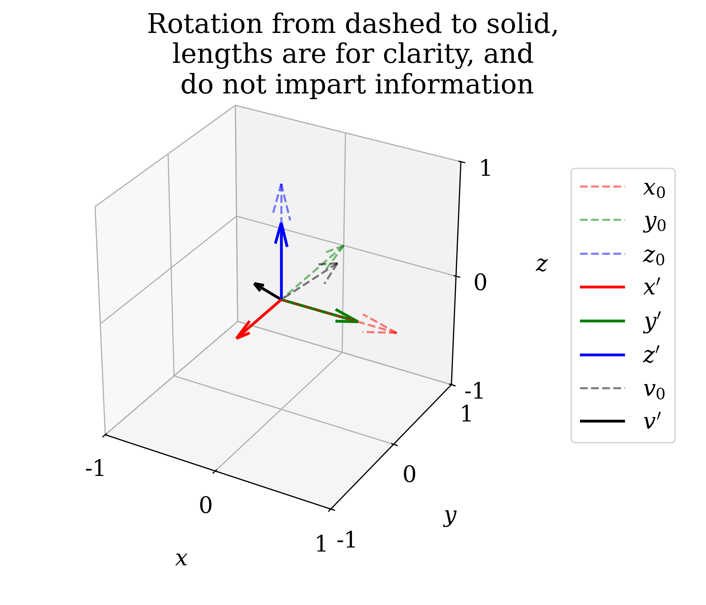

---
hide:
    - footer
---

# Rotation Visualizer

Rotation matrices are used throughout robotics and dynamics.
Sometimes they can be easily imagined, but other times there's
simply too much going on. I built this to avoid pulling out a
piece of paper everytime.

### The Code

```python
import numpy as np
import matplotlib.pyplot as plt

def vector_rotation_visualizer(rotation, pre_vector=None):
    '''
    Generates a figure to visualize/check a rotation is behaving properly.
    '''

    fig = plt.figure()
    ax = fig.add_subplot(projection='3d')
    fig.set_size_inches(7,6)
    plt.subplots_adjust(left=0.08, right=0.7)

    color_vec = ['r','g','b']
    axis_vec = [r"$x$", r"$y$", r"$z$"]
    for axis_ind, fixed_axis in enumerate(np.identity(3)):
        c_now = color_vec[axis_ind]
        label_now = axis_vec[axis_ind] + r"$_0$"
        ax.quiver(0,0,0, fixed_axis[0], fixed_axis[1], fixed_axis[2],
                    color=c_now, linestyle='dashed', alpha=0.5, label=label_now)

    # Separated for legend sequencing
    for axis_ind, fixed_axis in enumerate(np.identity(3)):
        c_now = color_vec[axis_ind]
        rotated = 0.67*rotation@fixed_axis
        label_now = axis_vec[axis_ind] + r"$'$"
        ax.quiver(0,0,0, rotated[0], rotated[1], rotated[2],
                    color=c_now, linewidth=2, label=label_now)

    if not(pre_vector is None):
        pre_vector /= np.linalg.norm(pre_vector)
        ax.quiver(0,0,0, pre_vector[0], pre_vector[1], pre_vector[2],
                    color='k', linestyle='dashed', alpha=0.5, label=r"$v_0$")
        rotated = 0.33*rotation@pre_vector
        ax.quiver(0,0,0, rotated[0], rotated[1], rotated[2],
                    color='k', linewidth=2, label=r"$v'$")


    ax.set_xlabel(r"$x$", labelpad=20)
    ax.set_ylabel(r"$y$", labelpad=20)
    ax.set_zlabel(r"$z$", labelpad=20)
    ax.set_xlim([-1,1])
    ax.set_ylim([-1,1])
    ax.set_zlim([-1,1])
    tick_vals = [-1,0,1]
    tick_labels = ['{:d}'.format(x) for x in tick_vals]
    ax.xaxis.set_ticks(tick_vals)
    ax.yaxis.set_ticks(tick_vals)
    ax.zaxis.set_ticks(tick_vals)
    ax.set_xticklabels(tick_labels)
    ax.set_yticklabels(tick_labels)
    ax.set_zticklabels(tick_labels)
    ax.legend(loc="center left", bbox_to_anchor=[1.15,0.5])
    ax.set_aspect('equal')
    fig.suptitle("Rotation from dashed to solid,\n lengths are for clarity, and \n do not impart information")
    plt.show()
```

### An Example:
#### Mathematically
Consider the following, where rotation $R$ acts on vector $v_0$ to generate $v'$

$$
\begin{align}
    v' &= Rv_0\\
    &=
\begin{bmatrix}
0 & 1 & 0\\
-1 & 0 & 0\\
0 & 0 & 1
\end{bmatrix} \begin{bmatrix}1 \\ -0.5\\ 1 \end{bmatrix}\\
&= \begin{bmatrix}-0.5\\-1\\1\end{bmatrix}
\end{align}
$$

#### Programmatically
The resulting 3D figure is thus.

{width="500"}

/// caption
///

---
see the code on my [GitHub](https://github.com/lbarker1996/python_and_matplotlib_snippets/tree/master/rotation_visualizer).