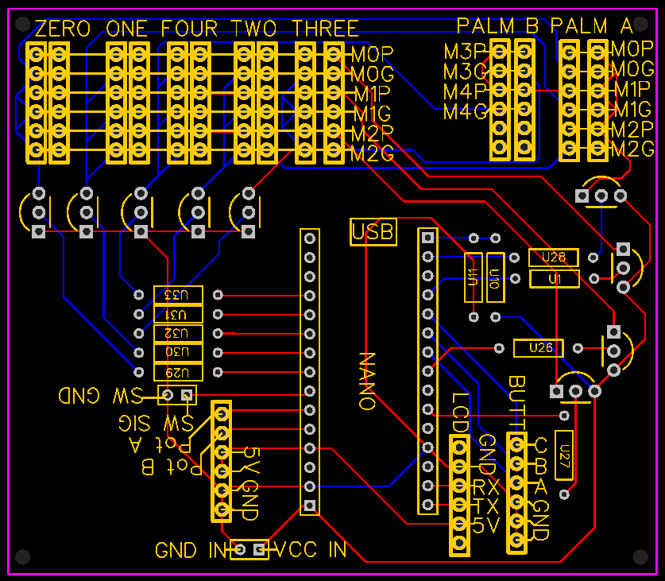
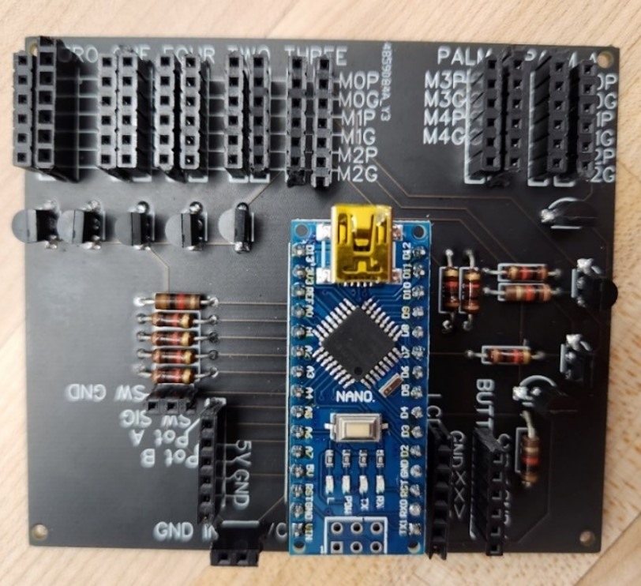
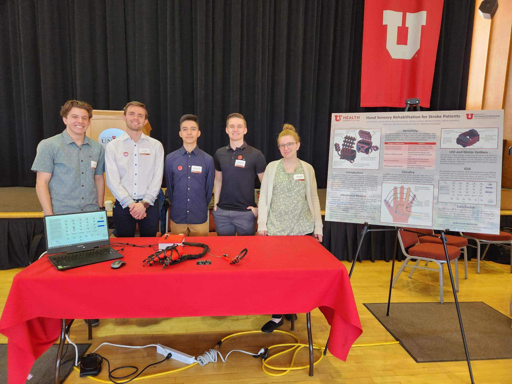

# Senior Design

### Introduction
**Hand Sensory Rehabilitation for Stroke Patients**: This project, motivated and advised by Dr. Sanford Meek,
and Dr. Mohommed Sbai, culminated my Bachelor degree in Mechanical Engineering.
In some stroke patients, the cortical pathways in the affected side of the body can become jumbled.
From the perspective of the stroke patient, this means that physical stimuli located on the pinky finger
might be percieved as ocurring on the thumb, and *vice-versa*.

Over the span of two semesters, I worked with in a group to understand the needs of potential users,
and realized a wearable haptic device for sensory rehabilitation in stroke patients.
The solution we created is intended to be used both in a clinical setting by a physical therapist,
and by the stroke patient themself at home.

The wearable portion of the device, which contains twenty vibrational motor-LED pairs, is
applied to the affected hand, with operation controled via a graphical user interface on a connected computer.
Each vibrational motor-LED pair can be individually activated, or the pairs can be activated in groups
(*i.e.*, individual fingers, or the palm).
Upon acitivation, the LED illuminates, and the vibrational motor vibrates (with pulse duration and intensity controlable).
The therapist (or other user) can activate these vibrational motor-LED pairs in the fashion of a quiz, with the
patient (hopefully) learning to correctly identify the location of the stimuli over time.

### My Contributions
Within this project, I championed the electrical design and created the initial Arduino
software used to tun the device (it was later ported over to LabView to achieve the graphical
user interface).

Control of the vibrational mototr-LED pairs ocurrs via multiplexing; that is, any individual
motor-LED pair can be individually activated by energizing the corresponding voltage and ground
connections. The graphic below gives an abstracted explanation.

<iframe
    src="./academic_showcase/senior_design/PalmCircuitB2.pdf"
    width="500px"
    height="500px"
    style="border: none;">
</iframe>
/// caption
Created using [draw.io](https://app.diagrams.net/); see code on [Github](https://github.com/lbarker1996/academic_showcase/tree/master/senior_design).
///

At the deeper level, here is the resulting electrical schematic, ECAD drawing for the
printed circtuit board (PCB) design, and the physical PCB populated with components.
<iframe
    src="./attachments/Schematic_PCB.pdf"
    width="750px"
    height="500px"
    style="border: none;">
</iframe>
/// caption
Electrical schematic; created using EasyEDA.
///

{width=85%}
/// caption
ECAD drawing of the PCB for routing power and signals; created using EasyEDA.
///

{width=85%}
/// caption
The physical PCB, populated with an Arduino NANO microcontroller, and all the necessary components.
///

### Design Day
The Department of Mechanical Engineering holds a public event every semester called Design Day.
At Design Day, any courses involving competitions are held, and the Senior Design
groups present their projects via poster and any relevant physical demonstrations.
For our demonstrations, we displayed the wearable haptic device on a 3D printed hand,
and allowed curious attendees to wear the device, and control it via the graphical user interface.

{loading=lazy, width=100%}
/// caption
The Design Day poster explaining our project.
/// 

{loading=lazy, width=100%}
/// caption
Group photo next to the Design Day poster; the group members left to right: Jordan Callus, **Levi Barker**, Jason Bermudez-Hernandez, Ethan Hawkins, Melissa Frisby.
///

### Final Report
If you're interested in the gory details, here is the final report we submitted.

<iframe
    src="./academic_showcase/senior_design/senior_design_final_report.pdf"
    width="100%"
    height="800px"
    style="border: none;">
</iframe>