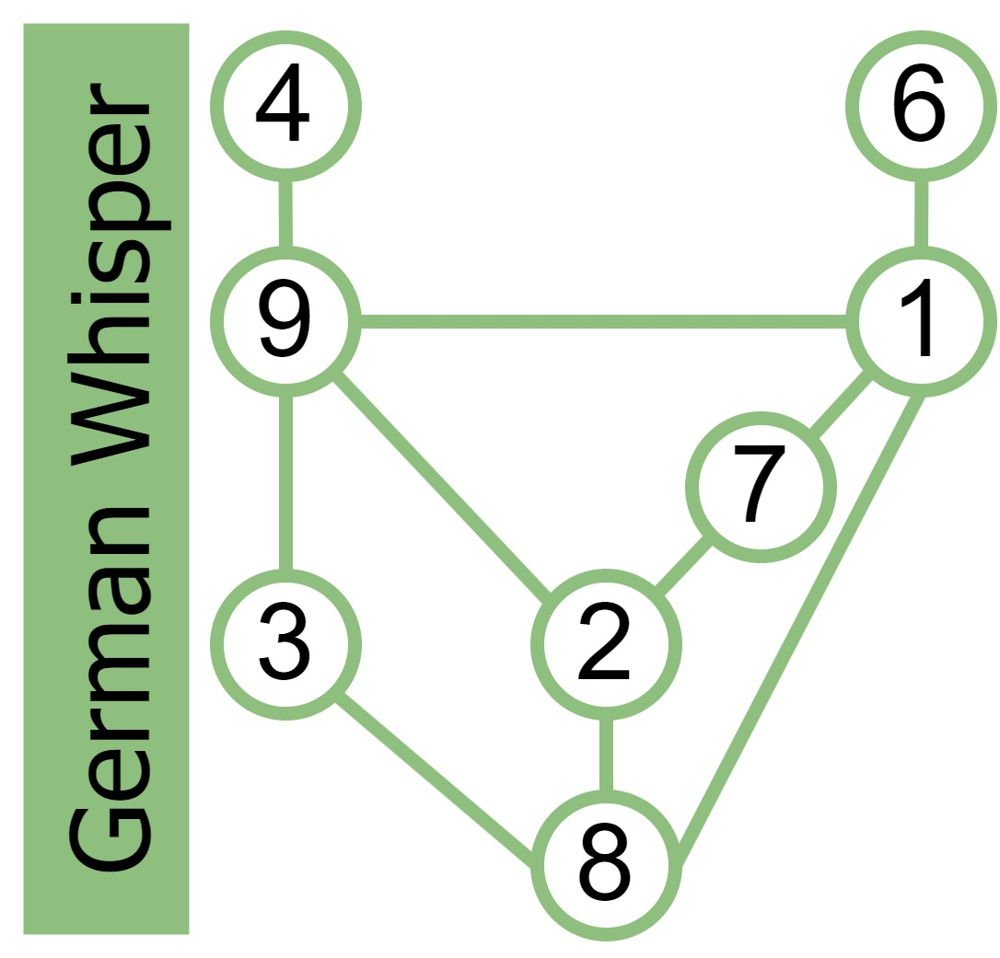

# Sudoku

### German Whispers
In variant Sudoku, *i.e.*, Sudoku with rules extending beyond the overlapping sets of 1-9, a popular rule that is used is called a **German Whisper Line**.
On this line, typically colored green, adjacent digits along the line must differ in value by at least five.
When I was first learning how this rule, I found it very difficult to keep the options for each digits straight.
So, I made this mathematical graph to remind myself of the rules.
The nodes are the normal Sudoku digits, and edges are present between digits that could be adjacent on the German Whisper Line.

{width=75%}
///caption
Made with [draw.io](https://app.diagrams.net/)
///

